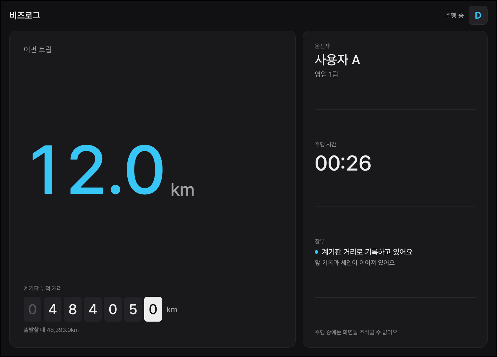
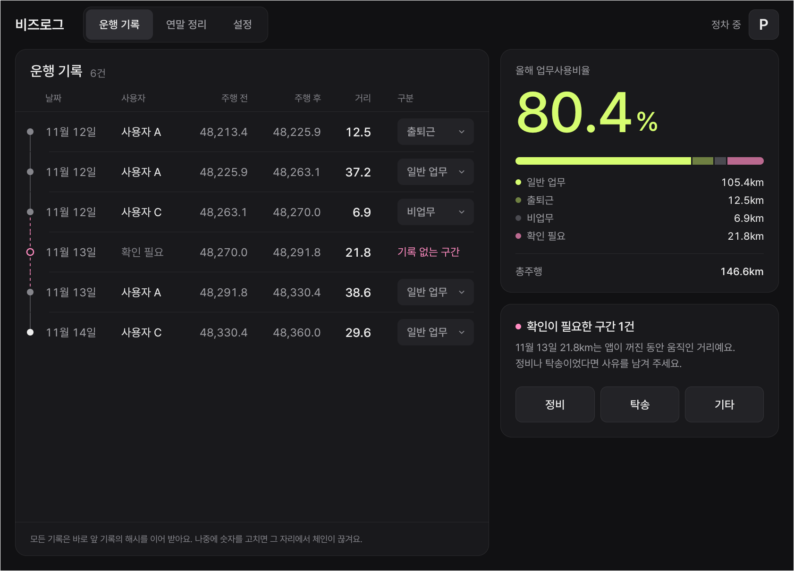
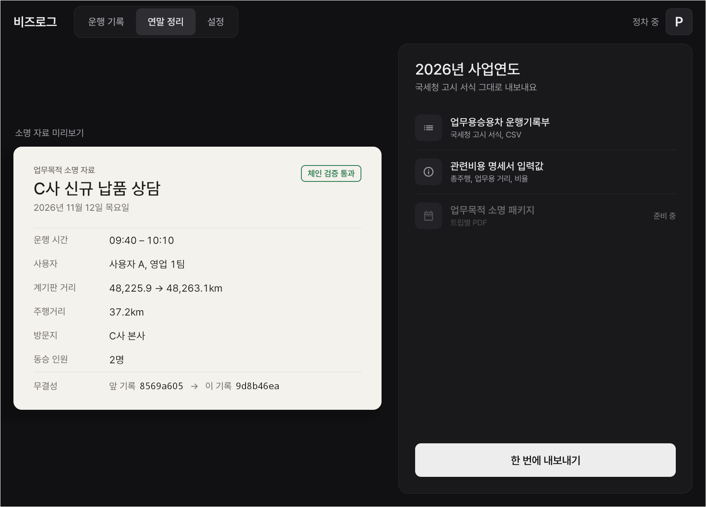

# 비즈로그 (BizLog)

> 시동을 걸면 계기판 주행거리(ODO)로 국세청 서식 운행기록부가 채워지는, 법인과 사업자 차량용 자동 장부 앱

현대자동차그룹 차량용 앱 개발 공모전 출품작. Pleos Connect(Android Automotive OS) 앱입니다.



## 무엇을 하나요

- **손대지 않는 트립 기록**: 기어와 계기판 ODO로 트립 시작과 종료를 판단해 출발, 도착 ODO를 남깁니다. 기어 P, 주차 브레이크, 또는 ODO가 5분 멈추면 종료합니다.
- **ODO 체인**: 이번 출발 ODO와 직전 도착 ODO가 다르면 그 차이를 누락 구간으로 자동 기록합니다. 모든 기록은 직전 기록의 SHA-256 해시를 이어 받아, 나중에 숫자를 고치면 체인이 끊겨 보입니다.
- **추가만 하는 장부**: 기존 기록은 고치지 않습니다. 구분 변경과 누락 사유는 정정 기록을 덧붙입니다.
- **정차 직후 음성 한마디**: 트립이 끝나면 TextToSpeech로 "이번 운행은 어떤 업무였나요?"라고 묻고, SpeechToText로 답을 들어 목적과 구분을 장부에 남깁니다. 못 들으면 버튼 세 개로 고릅니다. 음성은 ON_DEVICE로 처리해 차 밖으로 나가지 않습니다.
- **주행과 정차 화면 분리**: 주행 중에는 상태 화면 한 장만 보이고 누를 곳이 없습니다. 장부와 내보내기는 정차 중에만 열립니다(기어, CarUxRestrictions).
- **국세청 서식 내보내기**: 업무용승용차 운행기록부 항목 순서 그대로 CSV(UTF-8 BOM, CRLF)를 만들고 업무사용비율을 계산합니다.

| 운행 기록 | 연말 정리 |
|---|---|
|  |  |

나중에 장부 숫자를 고치면 그 자리부터 체인이 끊깁니다: [변조 시연 화면](docs/screenshots/ledger_tampered.png)

## 사용한 Pleos Connect SDK

| SDK | 버전 | 사용 기능 |
|---|---|---|
| Vehicle | 2.3.2 | Odometer(누적 거리), Gear(기어), Safety(주차 브레이크 경고등), CarInfo(VIN) |
| NaviHelper | 3.0.5 | 의존성 포함, 목적지 연동은 2차 PT 전 구현 예정 |
| TextToSpeech | 3.3.1 | 정차 직후 목적 질문, 기록 확인 안내 (ON_DEVICE) |
| SpeechToText | 3.3.1 | 목적 답변 인식 (ON_DEVICE) |
| AAOS Car API | 기기 제공 | CarUxRestrictions(주행 규제) |

모든 차량 신호는 `check…Capabilities`로 지원 여부를 먼저 확인합니다. 지원하지 않으면 그 기능만 끄고 앱은 계속 동작합니다.

## APK

- 위치: [`apk/유니버_BizLog_release.apk`](apk/유니버_BizLog_release.apk) (서명된 release, APK Signature Scheme v3)
- 설치: `adb install -r apk/유니버_BizLog_release.apk`

## 테스트 환경

| 항목 | 값 |
|---|---|
| 에뮬레이터 | **Pleos Connect Emulator v2.1.0** (Android 14, API 34, Automotive, arm64, RAM 4GB, Cold boot) |
| 화면 규격 | **2560×1440 px, 160 dpi** (`adb shell wm size`, `wm density`). 앱 창은 런처 오른쪽 영역 1682×1210 |
| Virtual Console | 에뮬레이터 v2.1.0 내장, `adb forward tcp:8088 tcp:8088` 후 http://127.0.0.1:8088/ |
| 빌드 | JDK 17, Gradle 8.10.2, AGP 8.8.2, Kotlin 2.0.21, minSdk 28, targetSdk 35 |

## 실행 방법

1. Pleos Connect Emulator v2.1.0 AVD를 **Cold boot**로 실행합니다. Virtual Console의 ODO는 내릴 수 없으므로, 처음부터 시연하려면 Cold boot로 0부터 시작합니다.
2. APK를 설치하고 런처에서 **비즈로그**를 실행합니다. 첫 실행 때 기록 서비스가 시작되고, 이후에는 부팅 때 자동으로 시작됩니다.
3. Virtual Console을 연결합니다: `adb forward tcp:8088 tcp:8088` → http://127.0.0.1:8088/ → Emulation Controls
4. 시연 순서
   1. Gear Selection **D**, Odometer 값을 올립니다 → 주행 화면, 이번 트립 거리가 늘어납니다.
   2. Gear **P** → 운행 기록에 트립이 추가되고, 음성으로 목적을 묻습니다. 답을 들으면 목적과 구분이 장부에 남습니다. 구분은 운행 기록에서 언제든 바꿀 수 있습니다.
   3. `adb shell am force-stop kr.univer.bizlog` → Odometer를 올립니다 → 앱을 다시 실행 → D → 값을 올리고 → P. **누락 구간**이 자동으로 생깁니다.
   4. 연말 정리 → 한 번에 내보내기 → 기기의 다운로드/BizLog 폴더에 CSV가 저장됩니다.
- 에뮬레이터 마이크가 꺼져 있으면 음성 답변이 들어오지 않습니다. 시연 도구의 **녹음된 답변으로 음성 인식**을 켜면, 마이크 대신 "거래처 신규 납품 상담" 녹음(16kHz PCM)을 같은 SpeechToText 엔진에 넣어 인식합니다.
- 시연 도구(데모 장부 불러오기, 장부 변조 시뮬레이션, 녹음된 답변, 전체 삭제)는 숨겨져 있습니다. 상단의 **비즈로그** 글자를 다섯 번 누르면 설정에 나타납니다.
- 에뮬레이터 시간대가 한국이 아니면 기록 시각이 다르게 보입니다: `adb shell service call alarm 3 s16 Asia/Seoul`

## 빌드

```bash
./gradlew testDebugUnitTest   # 도메인 단위 테스트
./gradlew assembleRelease     # 서명 키는 저장소에 포함하지 않음 (keystore.properties)
```

## 구조

```
kr.univer.bizlog
├─ domain/   순수 Kotlin. 트립 상태머신, ODO 체인과 해시, 업무사용비율, 용도 분류 (단위 테스트 대상)
├─ gateway/  SDK 경계. VehicleGateway, VoiceGateway 인터페이스와 Pleos 구현, Fake 구현(테스트와 폴백)
├─ data/     Room 장부(추가만), 설정, 데모 데이터
├─ service/  포그라운드 기록 서비스, 부팅 자동 시작
├─ export/   국세청 서식 CSV
└─ ui/       Compose 화면: 주행, 목적 질문, 운행 기록, 연말 정리, 설정
```

## 시연 영상

<YouTube 링크>

## 라이선스

- 글꼴: Pretendard (SIL Open Font License 1.1), [third_party/Pretendard/LICENSE.txt](third_party/Pretendard/LICENSE.txt)
